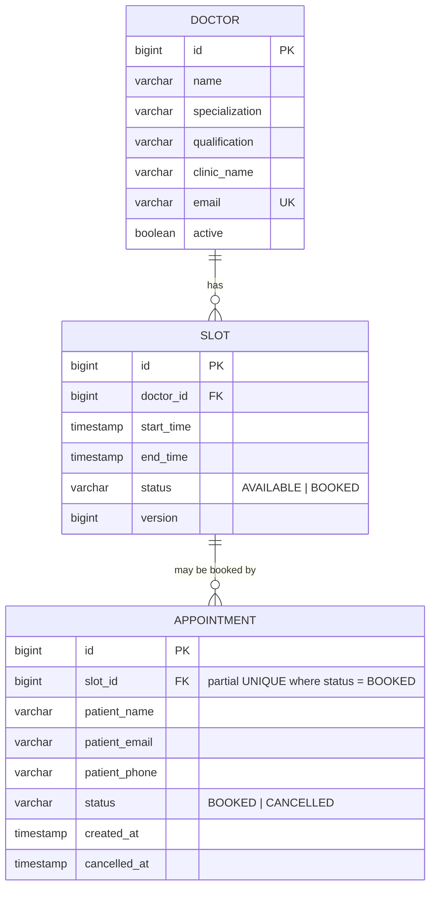
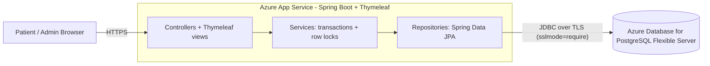

# OpenQ — Hospital & Clinic Appointment Booking

OpenQ is a small, server-rendered web app where patients pick a doctor, choose a free time slot and book an
appointment, and a clinic "admin" can review and cancel bookings. It is an **educational MVP** built to run on
very small hosts (e.g. an Azure App Service Free F1 plan) and to demonstrate **safe handling of concurrent
bookings**.

> **Not for real patient data.** There is no authentication, no authorization, no audit log and no privacy
> controls. See [Limitations](#limitations).

**Stack:** Java 21 · Spring Boot 3.5 (Web, Data JPA, Validation) · Thymeleaf · PostgreSQL · Maven · plain HTML/CSS ·
JUnit 5 / Mockito / MockMvc. One executable JAR, no frontend build, no Lombok.

## Features

| Area | What it does |
|---|---|
| Doctor directory | Lists active doctors with their number of upcoming open slots. |
| Slot selection | Shows a doctor's future `AVAILABLE` slots grouped by day. Booked or past slots are never offered. |
| Booking | Patient name, email and optional phone are validated (Jakarta Validation). On success the browser is redirected (Post/Redirect/Get) to a confirmation page showing appointment ID, doctor, date, time and patient. |
| Availability | A booked slot disappears from the slot list immediately; cancelling brings it back. |
| Admin dashboard (demo) | `/admin` lists all appointments, filters by doctor and/or status, and cancels bookings (POST only). |
| Concurrency safety | Row lock in a transaction **plus** a PostgreSQL partial unique index (see below). |
| Errors | Friendly HTML error pages (and JSON `ProblemDetail` for the REST endpoint). No SQL, stack traces or credentials are ever shown. |

### Why both a database constraint and transactional locking?

* **Row lock (service layer).** `AppointmentService.book()` runs in one transaction and loads the slot with
  `SELECT … FOR UPDATE` (`PESSIMISTIC_WRITE`). Concurrent requests for the same slot queue up; the first one marks
  the slot `BOOKED` and commits, the others then see `BOOKED` and get a clean "slot already booked" response.
  This gives good user-facing behaviour and no wasted failed inserts.
* **Partial unique index (database).** `CREATE UNIQUE INDEX ux_appointment_active_slot ON appointment(slot_id) WHERE status = 'BOOKED'`
  lets PostgreSQL itself guarantee *at most one BOOKED appointment per slot*. Application code can have bugs, a second
  app instance can run, someone can run manual SQL — the database still refuses a double booking. Cancelled rows are
  outside the index, so a cancelled slot can be rebooked and history is kept.
* A violation of the index is raised inside the booking transaction (`saveAndFlush`) and translated centrally by
  `GlobalExceptionHandler` into the same HTTP 409 "slot taken" page.

## Architecture

```
Browser → Controller → Service → Repository → PostgreSQL
              │            │          │
        Thymeleaf views  business    Spring Data JPA
        + form DTOs      rules,      (entities: Doctor, Slot, Appointment)
                         transactions
```

| Package | Responsibility |
|---|---|
| `com.openq.controller` | MVC controllers (`HomeController`, `BookingController`, `AdminController`) and one read-only `ApiController`. No business logic. |
| `com.openq.service` | `DoctorService`, `SlotService`, `AppointmentService` — rules, `@Transactional` boundaries, locking. |
| `com.openq.repository` | Spring Data JPA repositories, including the locking queries and join-fetch queries (no N+1). |
| `com.openq.entity` | JPA entities and enums (`SlotStatus`, `AppointmentStatus`). Unidirectional `@ManyToOne` only. |
| `com.openq.dto` | Form object (`BookingForm`) and view objects. Entities are never bound to forms. |
| `com.openq.exception` | Domain exceptions and the global `@ControllerAdvice` handlers. |
| `com.openq.config` | Clinic-local `Clock` bean. |

All times are clinic-local wall-clock `LocalDateTime` (`TIMESTAMP` without time zone) in the zone configured by
`openq.clinic-zone` (default `Asia/Kolkata`).

### Database Schema (ERD)



Other constraints (see `src/main/resources/schema.sql`): `UNIQUE (doctor_id, start_time)`, `CHECK (end_time > start_time)`,
status `CHECK`s, and `cancelled_at` must be set exactly when `status = 'CANCELLED'`.

## System Architecture Diagram



## Quickstart

### 1. Prerequisites

* **JDK 21** (17 also works if you change `java.version` in `pom.xml`) — check with `java -version`
* **Maven 3.9+** — check with `mvn -version`
* **PostgreSQL 14+** (16 recommended), local install or Docker

### 2. Create the database

Local PostgreSQL (replace `<your-password>`; you will be prompted for the `postgres` superuser password):

```bash
# macOS / Linux
psql -U postgres -c "CREATE ROLE openq LOGIN PASSWORD '<your-password>';"
psql -U postgres -c "CREATE DATABASE openq OWNER openq;"
psql -U postgres -c "CREATE DATABASE openq_test OWNER openq;"   # only needed for integration tests
```

```powershell
# Windows PowerShell (psql.exe must be on PATH)
psql -U postgres -c "CREATE ROLE openq LOGIN PASSWORD '<your-password>';"
psql -U postgres -c "CREATE DATABASE openq OWNER openq;"
psql -U postgres -c "CREATE DATABASE openq_test OWNER openq;"
```

Or with Docker:

```bash
docker run --name openq-pg -e POSTGRES_USER=openq -e POSTGRES_PASSWORD=<your-password> -e POSTGRES_DB=openq -p 5432:5432 -d postgres:16
docker exec openq-pg createdb -U openq openq_test
```

### 3. Configure environment variables

Spring Boot does not read `.env` files by itself. Export the variables in the shell you will run Maven from
(see `.env.example`):

```bash
# macOS / Linux
export DB_URL="jdbc:postgresql://localhost:5432/openq"
export DB_USERNAME="openq"
export DB_PASSWORD="<your-password>"
```

```powershell
# Windows PowerShell
$env:DB_URL = "jdbc:postgresql://localhost:5432/openq"
$env:DB_USERNAME = "openq"
$env:DB_PASSWORD = "<your-password>"
```

### 4. Schema and seed data

Nothing to run by hand. On every start Spring executes `schema.sql` (tables, constraints, the partial unique index)
and then `data.sql` (4 doctors and 10 half-hour slots per doctor per day for the next 7 days). Both scripts are
idempotent, so restarts never duplicate rows; on a later day only the new days' slots are added.
Hibernate runs with `ddl-auto=validate`: it only *checks* that entities match the tables.

### 5. Run the application

```bash
mvn spring-boot:run          # macOS / Linux / Windows (same command)
```

Open **http://localhost:8080** (patient) and **http://localhost:8080/admin** (demo admin).
If port 8080 is taken, set `PORT` (`export PORT=9090` / `$env:PORT = "9090"`).

### 6. Run the tests

```bash
mvn test                  # unit + web-layer tests (*Test): fast, NO database needed
mvn verify                # also runs the PostgreSQL integration tests (*IT): needs the openq_test database
mvn verify -DskipITs      # everything except the integration tests
```

**Unit tests** (`AppointmentServiceTest`, `BookingFormValidationTest`, `WebLayerTest`) use mocks/slices. They check
decision logic, validation, templates and HTTP status codes — they do **not** prove concurrency safety.

**Integration tests** (`BookingIT`) run against a *real* PostgreSQL: successful booking, double booking rejected,
cancel → rebook, double cancel, 8 threads racing for one slot (exactly one wins), the partial unique index with the
service bypassed, and seed-script idempotency. Point them at a throwaway database:

```bash
export TEST_DB_URL="jdbc:postgresql://localhost:5432/openq_test"
export TEST_DB_USERNAME="openq"
export TEST_DB_PASSWORD="<your-password>"
mvn verify
```

```powershell
$env:TEST_DB_URL = "jdbc:postgresql://localhost:5432/openq_test"
$env:TEST_DB_USERNAME = "openq"
$env:TEST_DB_PASSWORD = "<your-password>"
mvn verify
```

Testcontainers was deliberately not used: it needs Docker on every developer machine and adds dependencies; a plain
local PostgreSQL (or the PostgreSQL service container in `.github/workflows/deploy.yml`) is lighter.

### 7. Build the executable JAR

```bash
mvn clean package -DskipITs
java -jar target/openq.jar
```

The artifact is always `target/openq.jar` (`finalName` in `pom.xml`).

## Configuration reference

| Property / variable | Purpose |
|---|---|
| `DB_URL`, `DB_USERNAME`, `DB_PASSWORD` | PostgreSQL connection. No default password. |
| `PORT` | HTTP port. Azure App Service (Linux, Java SE) provides it; default `8080` locally. |
| `OPENQ_CLINIC_ZONE` | Clinic time zone for "is this slot in the future?" (default `Asia/Kolkata`). `data.sql` uses the same zone name literally; keep them in sync if you change it. |
| `spring.sql.init.mode=always` | Run `schema.sql` / `data.sql` on every start (needed because PostgreSQL is an external DB). Set env `SPRING_SQL_INIT_MODE=never` to stop it (e.g. after running the scripts with an admin account). |
| `spring.jpa.hibernate.ddl-auto=validate` | Hibernate must never create/alter tables; `schema.sql` is the single source of truth. |
| `spring.jpa.open-in-view=false` | No DB connection held while views render; forces explicit fetching (no hidden N+1). |
| `hikari.maximum-pool-size=5`, `minimum-idle=1` | Small pool for a small host / small database. |
| `hikari.connection-init-sql=SET lock_timeout='5s'` | A row lock wait longer than 5 s fails with a friendly "try again" page instead of hanging. |
| `server.error.include-*=never` | Never leak messages, stack traces or binding errors to browsers. |
| `server.shutdown=graceful` | Finish in-flight requests on restart. |

## Core API / Route Endpoint Mapping

**Browser routes** (server-rendered HTML):

| Method | Path | Purpose | Access level |
|---|---|---|---|
| GET | `/` | Home page | Public (patient view) |
| GET | `/doctors` | Doctor directory with open-slot counts | Public (patient view) |
| GET | `/doctors/{doctorId}/slots` | A doctor's available slots | Public (patient view) |
| GET | `/slots/{slotId}/book` | Booking form for a slot | Public (patient view) |
| POST | `/slots/{slotId}/book` | Submit booking → `302` to confirmation (`409` if slot taken) | Public (patient view) |
| GET | `/appointments/{appointmentId}/confirmation` | Confirmation page | Public — **anyone with the ID can view it** |
| GET | `/admin` | Dashboard; optional `?doctorId=` and `?status=BOOKED\|CANCELLED` | **Demo admin — no authentication** |
| POST | `/admin/appointments/{appointmentId}/cancel` | Cancel an appointment, free its slot → `302` to `/admin` | **Demo admin — no authentication** |

**REST endpoint** (JSON):

| Method | Path | Purpose | Access level |
|---|---|---|---|
| GET | `/api/doctors/{doctorId}/slots` | Upcoming available slots as `[{slotId, startTime, endTime}]`; `404` `application/problem+json` for an unknown doctor | Public, read-only |

Destructive operations are POST-only. Status codes: `404` not found, `409` slot taken / already cancelled,
`400` malformed id, `503` lock timeout (retry), `500` unexpected (generic page).

## Troubleshooting

| Symptom | Likely cause and fix |
|---|---|
| `Connection to localhost:5432 refused` / `UnknownHostException` | PostgreSQL is not running, wrong host/port in `DB_URL`, or (Azure) firewall rule missing. Test with `psql "host=… port=5432 dbname=openq user=…"`. |
| `password authentication failed for user "openq"` | `DB_USERNAME`/`DB_PASSWORD` do not match the role. Variables must be exported in the *same shell* that starts Maven. Empty password = `DB_PASSWORD` not set. |
| `database "openq" does not exist` | Run the `CREATE DATABASE` step. |
| `Port 8080 was already in use` | Another process uses it. Set `PORT=9090` (or stop the other process). |
| `Schema-validation: missing table / wrong column type` | The database has an older/different schema. For a throwaway DB: drop and recreate it. Otherwise align `schema.sql` and the entities (Hibernate will not fix it for you — by design). |
| `permission denied for schema public` | The DB user needs to own the database (or have `CREATE` on schema `public`) because `schema.sql` runs at startup. |
| "Sorry, that time slot has just been taken" (HTTP 409) | Expected: someone else booked it first, or you resubmitted a form. Choose another slot. |
| Doctor list empty / "no open slots" | Seed did not run (`spring.sql.init.mode` changed?) or all slots are in the past/booked. Restart once: `data.sql` adds the next 7 days idempotently. |
| `*IT` tests fail with connection errors | The `openq_test` database or `TEST_DB_*` variables are missing. Use `mvn verify -DskipITs` to skip them. |

## Limitations

* **No authentication, authorization or CSRF protection.** `/` (patient) and `/admin` (admin) are just different URLs.
  This "role switching" is a *UI simulation only*: anyone who types `/admin` can see every patient's name, email and
  phone and can cancel any appointment. Spring Security is intentionally not included, so forms carry no CSRF tokens.
* The confirmation page is addressable by a sequential appointment ID — anyone can enumerate other patients' details.
* No emails/SMS, no rescheduling, no doctor-managed calendars, no time-zone handling beyond one clinic zone.
* Making this suitable for real patient data would require at least: real authentication (e.g. OIDC / Microsoft Entra ID),
  role-based authorization (patient sees only their own bookings; staff/doctor scopes), CSRF protection and secure
  session handling, unguessable confirmation tokens, audit logging of every access and change, encryption and key
  management, data-retention/deletion processes, monitoring and alerting, backups, and a legal/compliance review
  for the applicable regulation (e.g. HIPAA, GDPR, India's DPDP Act). OpenQ does none of this and **must not be used
  for real patient data**.

## Deploying to Azure

See [AZURE_DEPLOYMENT.md](AZURE_DEPLOYMENT.md).
